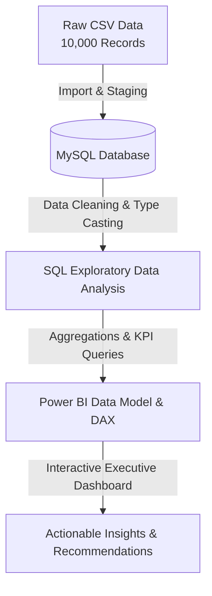

# 🏦 Bank Customer Churn Analysis & Predictive Insights

[](https://github.com/)
[](https://www.mysql.com/)
[](https://powerbi.microsoft.com/)
[](https://github.com/)

An end-to-end data analytics project investigating customer attrition for a retail bank. This project spans raw data ingestion, SQL-based data cleaning and exploratory data analysis (EDA), and an interactive Power BI executive dashboard designed to uncover key drivers of customer churn and deliver actionable retention strategies.

---

## 🎯 1. Project Overview & Business Problem

Customer acquisition cost in the banking sector is significantly higher than customer retention. Leadership identified an escalating attrition trend where profitable accounts were closing their accounts unexpectedly. 

* **The Business Problem**: The bank is experiencing an overall customer churn rate of **20.37%** (2,037 out of 10,000 customers). Without targeted intervention, this ongoing attrition erodes fee income, diminishes long-term customer lifetime value (LTV), and concentrates risk in high-value asset brackets.
* **The Solution**: Conduct a granular multi-dimensional analysis using SQL and Power BI to identify high-risk customer segments, evaluate product adoption bottlenecks, and equip management with data-driven retention triggers.

---

## 🎯 2. Project Objectives

* Calculate the baseline churn rate and quantify financial losses across account balances and salaries.
* Evaluate regional performance to determine if geographic concentration drives attrition.
* Analyze product adoption thresholds to understand why customers utilizing multiple products are leaving.
* Assess customer engagement impact (active membership status and credit card ownership).
* Investigate demographic risk factors (age cohorts and gender) and credit score tiers.

---

## 🛠️ 3. Tools & Technologies Used

* **Database & Querying**: MySQL Workbench (Data cleaning, schema alteration, aggregation queries, CTEs, and window functions).
* **Data Visualization & Business Intelligence**: Power BI Desktop (DAX measures, interactive filtering, slicers, and executive dashboard layout).
* **Data Processing & Spreadsheet Tools**: Microsoft Excel (Data verification and initial profiling).
* **Version Control & Documentation**: Git & GitHub (Repository architecture, Markdown documentation, and portfolio presentation).

---

## 📊 4. Dataset Description

The dataset comprises **10,000 customer records** with the following key attributes:
* **Demographics**: `Geography` (France, Germany, Spain), `Gender`, `Age`.
* **Banking Profile**: `CreditScore`, `Tenure` (years with bank), `Balance` (account balance), `NumOfProducts` (bank products held).
* **Engagement Indicators**: `HasCrCard` (1 = Yes, 0 = No), `IsActiveMember` (1 = Yes, 0 = No), `EstimatedSalary`.
* **Target Variable**: `Exited` (1 = Churned, 0 = Retained).

*Limitations*: The dataset represents a cross-sectional snapshot without explicit time-series timestamps for exact churn dates, limiting seasonality analysis.

---

## 🔄 5. Project Workflow



---

## 🧹 6. Data Cleaning & Preparation
Before analysis, raw binary indicators were standardized to improve reporting clarity in SQL and Power BI:
1. **Schema Modification**: Altered columns IsActiveMember and HasCrCard from numeric INT flags to VARCHAR(10) categorical text.
```sql
ALTER TABLE bank_churn
MODIFY IsActiveMember VARCHAR(10),
MODIFY HasCrCard VARCHAR(10);
```
2. **Value Mapping**:
    * **IsActiveMember**:Converted 1 to 'Yes' and 0 to 'No'.
    * **HasCrCard**: Converted 1 to 'Yes' and 0 to 'No'
```sql
UPDATE bank_churn
SET IsActiveMember = 'Yes'
WHERE IsActiveMember = '1';

UPDATE bank_churn
SET IsActiveMember = 'No'
WHERE IsActiveMember = '0';

UPDATE bank_churn
SET HasCrCard = 'Yes'
WHERE HasCrCard = '1';

UPDATE bank_churn
SET HasCrCard = 'No'
WHERE HasCrCard = '0';
```
3. **Data Quality Audit**: Verified zero duplicate CustomerId entries and confirmed no missing values across critical financial and demographic fields
```sql
SELECT COUNT(DISTINCT CustomerId) FROM bank_churn;
```
