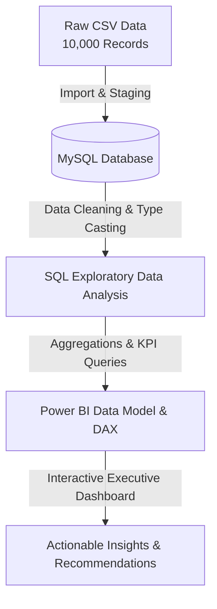

# 🏦 Bank Customer Churn Analysis & Predictive Insights

[](https://github.com/)
[](https://www.mysql.com/)
[](https://powerbi.microsoft.com/)
[](https://github.com/)

An end-to-end data analytics project investigating customer attrition for a retail bank. This project spans raw data ingestion, SQL-based data cleaning and exploratory data analysis (EDA), and an interactive Power BI executive dashboard designed to uncover key drivers of customer churn and deliver actionable retention strategies.

---

## 🎯 1. Project Overview & Business Problem

Customer acquisition cost in the banking sector is significantly higher than customer retention. Leadership identified an escalating attrition trend where profitable accounts were closing their accounts unexpectedly. 

* **The Business Problem**: The bank is experiencing an overall customer churn rate of **20.37%** (2,037 out of 10,000 customers). Without targeted intervention, this ongoing attrition erodes fee income, diminishes long-term customer lifetime value (LTV), and concentrates risk in high-value asset brackets.
* **The Solution**: Conduct a granular multi-dimensional analysis using SQL and Power BI to identify high-risk customer segments, evaluate product adoption bottlenecks, and equip management with data-driven retention triggers.

---

## 🎯 2. Project Objectives

* Calculate the baseline churn rate and quantify financial losses across account balances and salaries.
* Evaluate regional performance to determine if geographic concentration drives attrition.
* Analyze product adoption thresholds to understand why customers utilizing multiple products are leaving.
* Assess customer engagement impact (active membership status and credit card ownership).
* Investigate demographic risk factors (age cohorts and gender) and credit score tiers.

---

## 🛠️ 3. Tools & Technologies Used

* **Database & Querying**: MySQL Workbench (Data cleaning, schema alteration, aggregation queries, CTEs, and window functions).
* **Data Visualization & Business Intelligence**: Power BI Desktop (DAX measures, interactive filtering, slicers, and executive dashboard layout).
* **Data Processing & Spreadsheet Tools**: Microsoft Excel (Data verification and initial profiling).
* **Version Control & Documentation**: Git & GitHub (Repository architecture, Markdown documentation, and portfolio presentation).

---

## 📊 4. Dataset Description

The dataset comprises **10,000 customer records** with the following key attributes:
* **Demographics**: `Geography` (France, Germany, Spain), `Gender`, `Age`.
* **Banking Profile**: `CreditScore`, `Tenure` (years with bank), `Balance` (account balance), `NumOfProducts` (bank products held).
* **Engagement Indicators**: `HasCrCard` (1 = Yes, 0 = No), `IsActiveMember` (1 = Yes, 0 = No), `EstimatedSalary`.
* **Target Variable**: `Exited` (1 = Churned, 0 = Retained).

*Limitations*: The dataset represents a cross-sectional snapshot without explicit time-series timestamps for exact churn dates, limiting seasonality analysis.

---

## 🔄 5. Project Workflow



---

## 🧹 6. Data Cleaning & Preparation
Before analysis, raw binary indicators were standardized to improve reporting clarity in SQL and Power BI:
1. **Schema Modification**: Altered columns IsActiveMember and HasCrCard from numeric INT flags to VARCHAR(10) categorical text.
```sql
ALTER TABLE bank_churn
MODIFY IsActiveMember VARCHAR(10),
MODIFY HasCrCard VARCHAR(10);
```
2. **Value Mapping**:
    * **IsActiveMember**:Converted 1 to 'Yes' and 0 to 'No'.
    * **HasCrCard**: Converted 1 to 'Yes' and 0 to 'No'
```sql
UPDATE bank_churn
SET IsActiveMember = 'Yes'
WHERE IsActiveMember = '1';

UPDATE bank_churn
SET IsActiveMember = 'No'
WHERE IsActiveMember = '0';

UPDATE bank_churn
SET HasCrCard = 'Yes'
WHERE HasCrCard = '1';

UPDATE bank_churn
SET HasCrCard = 'No'
WHERE HasCrCard = '0';
```
3. **Data Quality Audit**: Verified zero duplicate CustomerId entries and confirmed no missing values across critical financial and demographic fields
```sql
SELECT COUNT(DISTINCT CustomerId) FROM bank_churn;
```

---

## 💻 7. SQL Analysis & Key Questions Answered
```sql
-- 1. Overall Customer Churn Rate
-- What is our overall customer churn rate and total customer breakdown?
SELECT
    COUNT(*) AS total_customers,
    SUM(CASE WHEN Exited = 0 THEN 1 ELSE 0 END) AS retained_customers,
    SUM(CASE WHEN Exited = 1 THEN 1 ELSE 0 END) AS churned_customers,
    ROUND((SUM(CASE WHEN Exited = 1 THEN 1 ELSE 0 END) * 100.0) / COUNT(*), 2) AS churn_rate_pct
FROM bank_churn;


-- 2. Total Balance & Salary by Churn Status
-- How do financial totals (balances and salaries) compare between retained and churned customers?
SELECT 
    CASE 
        WHEN Exited = 1 THEN 'Churned Customers'
        ELSE 'Retained Customers'
    END AS customer_bracket,
    COUNT(*) AS total_customers,
    ROUND(SUM(Balance), 2) AS total_balance,
    ROUND(SUM(EstimatedSalary), 2) AS total_estimated_salary
FROM bank_churn
GROUP BY customer_bracket;


-- 3. Regional Churn Volumes & Rates
-- How do churn volumes and rates differ across our primary geographic regions?
SELECT
    Geography,
    COUNT(*) AS total_customers,
    SUM(CASE WHEN Exited = 0 THEN 1 ELSE 0 END) AS retained_customers,
    SUM(CASE WHEN Exited = 1 THEN 1 ELSE 0 END) AS churned_customers,
    ROUND(AVG(Exited) * 100, 2) AS churn_rate_pct
FROM bank_churn
GROUP BY Geography
ORDER BY churn_rate_pct DESC;


-- 4. Financial Impact: Averages & Balance Brackets
-- Part A: How do average account balances and estimated salaries correlate with churn?
SELECT 
    Exited,
    COUNT(*) AS total_customers,
    ROUND(AVG(Balance), 2) AS avg_balance,
    ROUND(AVG(EstimatedSalary), 2) AS avg_salary
FROM bank_churn
GROUP BY Exited;

-- Part B: Are we losing high-value accounts across specific balance brackets?
SELECT 
    CASE 
        WHEN Balance = 0 THEN '01. Zero Balance'
        WHEN Balance < 50000 THEN '02. Low Balance (<50k)'
        WHEN Balance < 100000 THEN '03. Mid Balance (50k-100k)'
        WHEN Balance < 150000 THEN '04. High Balance (100k-150k)'
        ELSE '05. Very High Balance (150k+)'
    END AS balance_bracket,
    COUNT(*) AS total_customers,
    SUM(Exited) AS churned_customers,
    ROUND(AVG(Exited) * 100, 2) AS churn_rate_pct
FROM bank_churn
GROUP BY balance_bracket
ORDER BY balance_bracket;


-- 5. Product Adoption & Thresholds
-- How does the number of bank products utilized affect customer likelihood of churning?
SELECT 
    NumOfProducts,
    COUNT(*) AS total_customers,
    SUM(CASE WHEN Exited = 0 THEN 1 ELSE 0 END) AS retained_customers,
    SUM(CASE WHEN Exited = 1 THEN 1 ELSE 0 END) AS churned_customers,
    ROUND(AVG(Exited) * 100, 2) AS churn_rate_pct
FROM bank_churn
GROUP BY NumOfProducts
ORDER BY NumOfProducts;


-- 6. Engagement & Activity Impact
-- To what extent do active membership status and credit card ownership impact customer retention?
SELECT
    IsActiveMember,
    HasCrCard,
    COUNT(*) AS total_customers,
    SUM(CASE WHEN Exited = 0 THEN 1 ELSE 0 END) AS retained_customers,
    SUM(CASE WHEN Exited = 1 THEN 1 ELSE 0 END) AS churned_customers,
    ROUND(AVG(Exited) * 100, 2) AS churn_rate_pct
FROM bank_churn
GROUP BY IsActiveMember, HasCrCard
ORDER BY IsActiveMember DESC, HasCrCard DESC;


-- 7. Demographic Risk Factors (Age Group & Gender)
-- How do age groups and gender distributions influence churn behavior and risk?
SELECT 
    CASE 
        WHEN Age BETWEEN 18 AND 29 THEN '18-29'
        WHEN Age BETWEEN 30 AND 39 THEN '30-39'
        WHEN Age BETWEEN 40 AND 49 THEN '40-49'
        WHEN Age BETWEEN 50 AND 59 THEN '50-59'
        ELSE '60+'
    END AS age_group,
    Gender,
    COUNT(*) AS total_customers,
    SUM(CASE WHEN Exited = 0 THEN 1 ELSE 0 END) AS retained_customers,
    SUM(CASE WHEN Exited = 1 THEN 1 ELSE 0 END) AS churned_customers,
    ROUND(AVG(Exited) * 100, 2) AS churn_rate_pct
FROM bank_churn
GROUP BY age_group, Gender
ORDER BY churn_rate_pct DESC;


-- 8. Tenure & Loyalty Milestones
-- What is the relationship between customer tenure and churn rate, and at which milestones are customers most vulnerable?
SELECT
    Tenure,
    COUNT(*) AS total_customers,
    SUM(CASE WHEN Exited = 0 THEN 1 ELSE 0 END) AS retained_customers,
    SUM(CASE WHEN Exited = 1 THEN 1 ELSE 0 END) AS churned_customers,
    ROUND(AVG(Exited) * 100, 2) AS churn_rate_pct
FROM bank_churn
GROUP BY Tenure
ORDER BY Tenure;


-- 9. Credit Risk Profile
-- Part A: How do the average credit scores of churned customers compare to retained customers?
SELECT 
    Exited,
    COUNT(*) AS total_customers,
    ROUND(AVG(CreditScore), 2) AS avg_credit_score,
    MIN(CreditScore) AS min_credit_score,
    MAX(CreditScore) AS max_credit_score
FROM bank_churn
GROUP BY Exited;

-- Part B: Are customers with lower credit scores driving our attrition across credit tiers?
SELECT 
    CASE 
        WHEN CreditScore < 500 THEN '1. Poor (<500)'
        WHEN CreditScore BETWEEN 500 AND 650 THEN '2. Fair (500-650)'
        WHEN CreditScore BETWEEN 651 AND 750 THEN '3. Good (651-750)'
        ELSE '4. Excellent (751+)'
    END AS credit_score_tier,
    COUNT(*) AS total_customers,
    SUM(Exited) AS churned_customers,
    ROUND(AVG(Exited) * 100, 2) AS churn_rate_pct
FROM bank_churn
GROUP BY credit_score_tier
ORDER BY credit_score_tier;
```

---

## 📌 8. Key Performance Indicators (KPIs)
| KPI Name | Value | Business Relevance |
|-----------|-------|--------------------|
| Total Customers | 10,000 | Baseline active customer base scale. |
| Churned Customers | 2,037 | Total customer loss volume. |
| Overall Churn Rate | 20.37% | Primary health metric for customer retention. |
| Avg Balance (Churned) | $91,108.54 | $91,108.54 | Financial exposure of departing accounts. | 

--- 

## 🖼️ 9. Power BI Dashboard Preview
Interactive Dashboard View


---

## 💡 10. Key Findings & Business Insights
1. **Germany Outlier Risk**: Despite having equal customer volume to Spain (~2.5K), Germany accounts for **814 churned customers** (**32.44% churn rate**), nearly double the churn rate of France and Spain.

2. **Product Over-Concentration Trap**: Customers holding 3 products have an alarming **82.71% churn rate**, and those with 4 products experience **100%** churn. This indicates structural failure or poor onboarding in bundled advanced services.
  
3. **Age Cohort Vulnerability**: Attrition peaks sharply in the **50–59 age bracket**, reaching **62.95%** for females and **49.55%** for males, representing a critical demographic bleeding high-net-worth senior clients.
   
4. **Activity Status Protection**: Inactive members account for the vast majority of customer loss, proving that proactive engagement campaigns directly mitigate churn risk.  

---

## 🚀 11. Strategic Recommendations
* **Deploy German Market Intervention**: Investigate localized customer service quality, competitive product offerings, and fee structures in Germany to reverse the 32.4% attrition spike.

* **Restructure Multi-Product Bundles**: Audit products 3 and 4 (e.g., specialized investment or mortgage add-ons) to resolve usability friction or unexpected fee disclosures.

* **Senior Client Retention Taskforce**: Establish dedicated relationship management for the 50–59 age demographic, offering personalized financial advisory services.

* **Automated Re-engagement Triggers**: Set up CRM alerts for customers who become inactive for >90 days to deliver targeted incentives before account closure.

--- 

## ⚠️ 12. Challenges & Limitations
* **Cross-Sectional Data**: The dataset lacks historical longitudinal timestamps, preventing exact survival analysis or time-to-churn modeling.

* **Causality Limitations**: While strong correlations exist (e.g., age 50–59 and product count), qualitative exit-interview feedback would enrich the root-cause analysis.

--- 

## 📂 13. Repository Structure & Navigation
* [Bank_Churn.csv](./Bank_Churn.csv): Contains the original unedited [Bank_Churn.csv](./Bank_Churn.csv) dataset

* [bank_churn.sql](./bank_churn.sql): Contains modular SQL scripts for data cleaning and analytical queries.

* [bank_churn_dax_and_dashboard.pbix](./bank_churn_dax_and_dashboard.pbix): Contains dashboard screenshots and the .pbix report file.

## ⚙️ 14. How to Reproduce This Analysis
1. **Database Setup**: Clone the repository and import sql/data_cleaning.sql and sql/exploratory_analysis.sql into MySQL Workbench.

2. **Power BI Exploration**: Open powerbi/bank_churn_dashboard.pbix in Power BI Desktop to explore slicers, filters, and DAX measures.

3. **Verification**: Run the verification queries in sql/ to cross-check KPIs against the Power BI summary cards.

---

## 👤 15. Author & Acknowledgments
* Jhernwin E. Flora

* Aspiring Data Analyst | BS Mathematics Graduate

* GitHub Profile  | LinkedIn Profile https://www.linkedin.com/in/jhernwin-flora-8a972a3a7/?isSelfProfile=true
